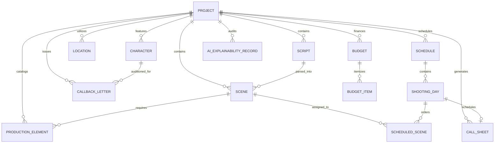

# Relational Database Schema & Data Dictionary

This document details the relational data model for the **AI-Powered Movie Pre-Production Planning & Production Management System**. The database is implemented using **SQLAlchemy 2.0 ORM**, defaulting to SQLite for zero-configuration portability while fully compatible with PostgreSQL.

---

## 1. Entity-Relationship Diagram (ERD)

---

## 2. Table Specifications & Data Dictionary

### 2.1 `projects`
Stores high-level metadata regarding a film production.

| Column | Type | Constraints | Description |
| :--- | :--- | :--- | :--- |
| `id` | `VARCHAR(36)` | PRIMARY KEY | Unique UUID identifier |
| `title` | `VARCHAR(255)` | NOT NULL | Working title of the motion picture |
| `director` | `VARCHAR(255)` | NULLABLE | Attached director |
| `producer` | `VARCHAR(255)` | NULLABLE | Attached lead producer |
| `production_company` | `VARCHAR(255)` | NULLABLE | Financing/production entity |
| `genre` | `VARCHAR(100)` | NULLABLE | Film genre (e.g., Sci-Fi, Drama) |
| `target_budget` | `FLOAT` | NULLABLE | Target financing cap in USD |
| `created_at` | `DATETIME` | NOT NULL | Record creation timestamp |
| `updated_at` | `DATETIME` | NOT NULL | Last update timestamp |

---

### 2.2 `scripts`
Tracks the ingested screenplay document, OCR metrics, and text extraction quality.

| Column | Type | Constraints | Description |
| :--- | :--- | :--- | :--- |
| `id` | `VARCHAR(36)` | PRIMARY KEY | Unique UUID identifier |
| `project_id` | `VARCHAR(36)` | FOREIGN KEY (`projects.id`) | Owning project |
| `filename` | `VARCHAR(255)` | NOT NULL | Stored PDF filename |
| `file_path` | `VARCHAR(512)` | NOT NULL | Absolute disk path to stored script |
| `raw_text` | `LONGTEXT` | NOT NULL | Extracted screenplay text stream |
| `page_count` | `INTEGER` | NOT NULL | Physical PDF page count |
| `ocr_applied` | `BOOLEAN` | DEFAULT FALSE | Whether PaddleOCR fallback triggered |
| `ocr_confidence` | `FLOAT` | DEFAULT 1.0 | Mean character confidence score |
| `text_quality_score` | `FLOAT` | DEFAULT 1.0 | Printable character density score |
| `created_at` | `DATETIME` | NOT NULL | Extraction timestamp |

---

### 2.3 `scenes`
Extracted screenplay scenes with slugline metadata and complexity scoring.

| Column | Type | Constraints | Description |
| :--- | :--- | :--- | :--- |
| `id` | `VARCHAR(36)` | PRIMARY KEY | Unique UUID identifier |
| `project_id` | `VARCHAR(36)` | FOREIGN KEY (`projects.id`) | Owning project |
| `script_id` | `VARCHAR(36)` | FOREIGN KEY (`scripts.id`) | Source screenplay |
| `scene_number` | `INTEGER` | NOT NULL | Chronological script scene number |
| `scene_heading` | `VARCHAR(255)` | NOT NULL | Full screenplay slugline |
| `location_name` | `VARCHAR(255)` | NOT NULL | Setting (e.g. MISSION CONTROL) |
| `setting_type` | `VARCHAR(20)` | NOT NULL | `INT.`, `EXT.`, or `INT./EXT.` |
| `time_of_day` | `VARCHAR(30)` | NOT NULL | `DAY`, `NIGHT`, `DUSK`, `DAWN` |
| `page_fraction` | `VARCHAR(10)` | NOT NULL | Film industry eighths (e.g. `2 3/8`) |
| `est_screen_time_seconds`| `INTEGER` | NOT NULL | Projected screen runtime (seconds) |
| `synopsis` | `TEXT` | NULLABLE | Scene summary narrative |
| `complexity_score` | `FLOAT` | DEFAULT 1.0 | Multi-factor complexity metric (1.0–5.0) |
| `complexity_level` | `VARCHAR(20)` | DEFAULT 'LOW' | `LOW`, `MEDIUM`, `HIGH`, `VERY HIGH` |
| `action_text` | `LONGTEXT` | NULLABLE | Raw scene action lines |
| `dialogue_text` | `LONGTEXT` | NULLABLE | Raw scene dialogue lines |

---

### 2.4 `characters`
Dramatis personae detected across speaking cues and action descriptions.

| Column | Type | Constraints | Description |
| :--- | :--- | :--- | :--- |
| `id` | `VARCHAR(36)` | PRIMARY KEY | Unique UUID identifier |
| `project_id` | `VARCHAR(36)` | FOREIGN KEY (`projects.id`) | Owning project |
| `name` | `VARCHAR(150)` | NOT NULL | Screenplay character name (uppercase) |
| `dialogue_count` | `INTEGER` | DEFAULT 0 | Count of spoken lines |
| `total_scenes` | `INTEGER` | DEFAULT 0 | Number of scenes character appears in |
| `estimated_shoot_days`| `INTEGER` | DEFAULT 1 | Projected on-set days |
| `cast_member_name` | `VARCHAR(255)` | NULLABLE | Attached or auditioning actor |
| `agent_name` | `VARCHAR(255)` | NULLABLE | Talent agent or representation |
| `agent_email` | `VARCHAR(255)` | NULLABLE | Agent contact email |
| `agent_phone` | `VARCHAR(50)` | NULLABLE | Agent contact phone |
| `notes` | `TEXT` | NULLABLE | Casting and character breakdown notes |

---

### 2.5 `locations`
Physical filming locations, sets, and company move anchors.

| Column | Type | Constraints | Description |
| :--- | :--- | :--- | :--- |
| `id` | `VARCHAR(36)` | PRIMARY KEY | Unique UUID identifier |
| `project_id` | `VARCHAR(36)` | FOREIGN KEY (`projects.id`) | Owning project |
| `name` | `VARCHAR(255)` | NOT NULL | Unique set/location name |
| `location_type` | `VARCHAR(20)` | NOT NULL | `INTERIOR` or `EXTERIOR` |
| `total_scenes` | `INTEGER` | DEFAULT 1 | Total scenes scheduled here |
| `est_total_shoot_days`| `FLOAT` | DEFAULT 1.0 | Cumulative production days required |
| `address` | `VARCHAR(512)` | NULLABLE | Physical filming address or stage # |
| `permit_required` | `BOOLEAN` | DEFAULT FALSE | City/location permit flag |
| `location_fee_per_day`| `FLOAT` | DEFAULT 0.0 | Daily rental rate |
| `notes` | `TEXT` | NULLABLE | Logistics, power, and sound notes |

---

### 2.6 `production_elements`
Departmental breakdown assets extracted via spaCy and Hugging Face NER.

| Column | Type | Constraints | Description |
| :--- | :--- | :--- | :--- |
| `id` | `VARCHAR(36)` | PRIMARY KEY | Unique UUID identifier |
| `project_id` | `VARCHAR(36)` | FOREIGN KEY (`projects.id`) | Owning project |
| `scene_id` | `VARCHAR(36)` | FOREIGN KEY (`scenes.id`) | Associated scene |
| `name` | `VARCHAR(255)` | NOT NULL | Physical element name |
| `category` | `VARCHAR(50)` | NOT NULL | `PROP`, `COSTUME`, `VEHICLE`, `EQUIPMENT`, `VFX`, `SFX`, `WEAPON`, `ANIMAL` |
| `description` | `TEXT` | NULLABLE | Departmental description |
| `is_critical` | `BOOLEAN` | DEFAULT FALSE | Flag for high-impact/hero props |
| `quantity` | `INTEGER` | DEFAULT 1 | Required count |

---

### 2.7 `schedules`, `shooting_days`, and `scheduled_scenes`
The production calendar optimized via Google OR-Tools CP-SAT.

#### `schedules`
| Column | Type | Constraints | Description |
| :--- | :--- | :--- | :--- |
| `id` | `VARCHAR(36)` | PRIMARY KEY | Unique UUID identifier |
| `project_id` | `VARCHAR(36)` | FOREIGN KEY (`projects.id`) | Owning project |
| `name` | `VARCHAR(255)` | NOT NULL | Schedule revision name |
| `total_days` | `INTEGER` | NOT NULL | Total principal photography days |
| `max_hours_per_day` | `FLOAT` | DEFAULT 12.0 | Maximum allowed on-set shooting hours |
| `status` | `VARCHAR(50)` | DEFAULT 'OPTIMIZED' | Solver status |

#### `shooting_days`
| Column | Type | Constraints | Description |
| :--- | :--- | :--- | :--- |
| `id` | `VARCHAR(36)` | PRIMARY KEY | Unique UUID identifier |
| `schedule_id` | `VARCHAR(36)` | FOREIGN KEY (`schedules.id`) | Parent schedule |
| `day_number` | `INTEGER` | NOT NULL | Day index (1, 2, 3...) |
| `shoot_date` | `DATE` | NOT NULL | Calendar shoot date |
| `est_total_hours` | `FLOAT` | NOT NULL | Sum of scene shooting hours |
| `company_moves_count`| `INTEGER` | DEFAULT 0 | Count of location moves this day |

#### `scheduled_scenes`
| Column | Type | Constraints | Description |
| :--- | :--- | :--- | :--- |
| `id` | `VARCHAR(36)` | PRIMARY KEY | Unique UUID identifier |
| `shooting_day_id` | `VARCHAR(36)` | FOREIGN KEY (`shooting_days.id`)| Assigned shoot day |
| `scene_id` | `VARCHAR(36)` | FOREIGN KEY (`scenes.id`) | Scheduled scene |
| `order_in_day` | `INTEGER` | NOT NULL | Filming order index |
| `est_shooting_hours` | `FLOAT` | NOT NULL | Allocated camera hours |
| `call_time` | `VARCHAR(20)` | DEFAULT '07:00' | Call time for this setup |
| `wrap_time` | `VARCHAR(20)` | DEFAULT '19:00' | Projected wrap time |

---

### 2.8 `budgets` and `budget_items`
Financial ledgers following standard industry chart of accounts.

#### `budgets`
| Column | Type | Constraints | Description |
| :--- | :--- | :--- | :--- |
| `id` | `VARCHAR(36)` | PRIMARY KEY | Unique UUID identifier |
| `project_id` | `VARCHAR(36)` | FOREIGN KEY (`projects.id`) | Owning project |
| `total_above_the_line`| `FLOAT` | DEFAULT 0.0 | Sum of ATL accounts (1000–1999) |
| `total_below_the_line`| `FLOAT` | DEFAULT 0.0 | Sum of BTL accounts (2000–4999) |
| `total_post_production`| `FLOAT`| DEFAULT 0.0 | Sum of Post accounts (5000–5999) |
| `contingency_rate` | `FLOAT` | DEFAULT 0.10 | 10% contingency buffer |
| `contingency_amount` | `FLOAT` | DEFAULT 0.0 | Calculated contingency |
| `tax_rate` | `FLOAT` | DEFAULT 0.08 | 8% state/provincial tax rate |
| `tax_amount` | `FLOAT` | DEFAULT 0.0 | Calculated tax liability |
| `grand_total` | `FLOAT` | DEFAULT 0.0 | Final estimated budget in USD |

#### `budget_items`
| Column | Type | Constraints | Description |
| :--- | :--- | :--- | :--- |
| `id` | `VARCHAR(36)` | PRIMARY KEY | Unique UUID identifier |
| `budget_id` | `VARCHAR(36)` | FOREIGN KEY (`budgets.id`) | Parent budget ledger |
| `account_code` | `VARCHAR(20)` | NOT NULL | Industry code (e.g. `2100`) |
| `category` | `VARCHAR(100)` | NOT NULL | Department category |
| `description` | `VARCHAR(255)` | NOT NULL | Line item description |
| `unit_type` | `VARCHAR(30)` | DEFAULT 'DAY' | `DAY`, `WEEK`, `FLAT`, `ALLOWANCE` |
| `unit_count` | `FLOAT` | DEFAULT 1.0 | Quantity of units |
| `rate` | `FLOAT` | DEFAULT 0.0 | Unit price rate |
| `total_cost` | `FLOAT` | DEFAULT 0.0 | `unit_count * rate` |
| `is_above_the_line` | `BOOLEAN` | DEFAULT FALSE | ATL vs BTL flag |

---

### 2.9 `call_sheets`
Daily call sheets containing crew call times, hospital directives, and logistics.

| Column | Type | Constraints | Description |
| :--- | :--- | :--- | :--- |
| `id` | `VARCHAR(36)` | PRIMARY KEY | Unique UUID identifier |
| `project_id` | `VARCHAR(36)` | FOREIGN KEY (`projects.id`) | Owning project |
| `shooting_day_id` | `VARCHAR(36)` | FOREIGN KEY (`shooting_days.id`)| Associated shoot day |
| `call_date` | `DATE` | NOT NULL | Call calendar date |
| `general_crew_call` | `VARCHAR(20)` | DEFAULT '07:00' | General crew call |
| `shoot_call` | `VARCHAR(20)` | DEFAULT '08:00' | First camera roll |
| `breakfast_time` | `VARCHAR(20)` | DEFAULT '06:00' | Catering breakfast |
| `lunch_time` | `VARCHAR(20)` | DEFAULT '13:00' | Mandatory 1-hour lunch |
| `estimated_wrap` | `VARCHAR(20)` | DEFAULT '19:00' | Camera wrap |
| `weather_forecast` | `VARCHAR(255)` | NULLABLE | On-location weather advisory |
| `nearest_hospital` | `VARCHAR(512)` | NOT NULL | 24-hr Emergency Medical Center address |
| `parking_notes` | `TEXT` | NULLABLE | Crew & basecamp parking |
| `production_notes` | `TEXT` | NULLABLE | Director/Safety notes |

---

### 2.10 `callback_letters`
Actor audition callback documents generated for talent agents.

| Column | Type | Constraints | Description |
| :--- | :--- | :--- | :--- |
| `id` | `VARCHAR(36)` | PRIMARY KEY | Unique UUID identifier |
| `project_id` | `VARCHAR(36)` | FOREIGN KEY (`projects.id`) | Owning project |
| `character_id` | `VARCHAR(36)` | FOREIGN KEY (`characters.id`) | Role being auditioned |
| `actor_name` | `VARCHAR(255)` | NOT NULL | Auditioning performer name |
| `agent_name` | `VARCHAR(255)` | NULLABLE | Talent agent representation |
| `agent_email` | `VARCHAR(255)` | NULLABLE | Agent email |
| `callback_datetime` | `VARCHAR(100)` | NOT NULL | Scheduled callback appointment |
| `audition_location` | `VARCHAR(255)` | NOT NULL | Casting studio address |
| `session_type` | `VARCHAR(100)` | NOT NULL | Audition format (e.g. Chemistry Read) |
| `sides_scene_id` | `VARCHAR(36)` | NULLABLE | Scene assigned for reading |
| `wardrobe_notes` | `TEXT` | NULLABLE | Wardrobe and grooming guidance |
| `director_notes` | `TEXT` | NULLABLE | Acting and subtext notes |
| `pdf_file_path` | `VARCHAR(512)` | NULLABLE | Rendered ReportLab PDF path |
| `created_at` | `DATETIME` | NOT NULL | Timestamp |

---

### 2.11 `ai_explainability_records`
Academic explainability audit log storing the model, technique, confidence score, and rationale for every AI decision.

| Column | Type | Constraints | Description |
| :--- | :--- | :--- | :--- |
| `id` | `VARCHAR(36)` | PRIMARY KEY | Unique UUID identifier |
| `project_id` | `VARCHAR(36)` | FOREIGN KEY (`projects.id`) | Owning project |
| `scene_id` | `VARCHAR(36)` | NULLABLE | Target scene reference |
| `entity_type` | `VARCHAR(100)` | NOT NULL | Element category or algorithm stage |
| `element_name` | `VARCHAR(255)` | NOT NULL | Classified item or decision |
| `ai_technique` | `VARCHAR(150)` | NOT NULL | Technique (e.g. Hugging Face BERT NER) |
| `model_name` | `VARCHAR(150)` | NOT NULL | Specific model artifact used |
| `confidence_score` | `FLOAT` | NOT NULL | Statistical confidence metric |
| `extraction_context`| `TEXT` | NULLABLE | Screenplay sentence snippet |
| `rationale` | `TEXT` | NOT NULL | Technical justification for classification |
| `timestamp` | `DATETIME` | NOT NULL | Logged timestamp |
